<h1 align="center">Frederico Benevides</h1>

  <strong>Software Engineer</strong> 
  Cloud Native | Java | Go | Node.js | Kubernetes

---

### About me

Brazilian software engineer with more than 20 years of experience in IT. I started my career as a Network Administrator and moved into software engineering in 2006 — a shift that gave me a solid grounding on both infrastructure and software. I do my best work in team environments, where knowledge is shared and everyone can grow.

---

### Tech stack

  
  
  
  
  

---

### GitHub stats

  
  

---

### Contribution graph

  <picture>
    <source media="(prefers-color-scheme: dark)" srcset="./profile/snake-dark.svg">
    <source media="(prefers-color-scheme: light)" srcset="./profile/snake.svg">
    
  </picture>

---

### Connect with me

  
  
  

